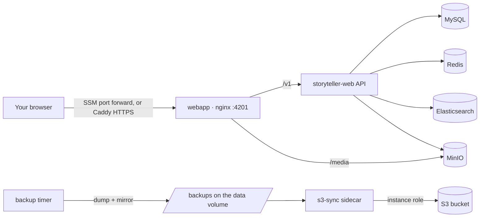

# Architecture

## Pieces

**Upstream stack.** `docker/docker-compose.yml` includes the Compose file of
artcraft-personal-server at the commit pinned in `UPSTREAM.lock`. That file builds the
ArtCraft API (`storyteller-web`), the web app behind nginx, MinIO and its client from
source, and runs MySQL, Redis and Elasticsearch from pinned images. Every published port
binds to 127.0.0.1. This repository does not copy or modify upstream files; it references
them, so its own scripts (`backup.sh`, `restore.sh`, `status.sh`) keep working unchanged.

**Add-ons.** Each is a Compose override file, switched on from `.env` by
`scripts/compose.sh`:

| File | Switch | Adds |
| --- | --- | --- |
| `docker-compose.s3.yml` | `S3_SYNC_ENABLED=true` | `s3-sync` sidecar |
| `docker-compose.caddy.yml` | `DOMAIN_NAME` set | Caddy with HTTPS and a sign-in prompt (experimental) |

**Where data lives.** Everything stateful is under `DATA_DIR` (default `/data/artcraft`):

| Path | Contents |
| --- | --- |
| `docker/` | Docker's data-root on AWS: named volumes (MySQL, MinIO, Redis, Elasticsearch) |
| `containerd/` | Images and build cache on AWS (recent Docker stores these in containerd, not the data-root) |
| `upstream/` | Pinned upstream checkout, with its generated `.env` (secrets) |
| `upstream/backups/` | Completed backups, one directory per UTC timestamp |
| `swapfile` | Swap |

On AWS, `DATA_DIR` is the mount point of a separate EBS volume. Terraform manages that
volume apart from the instance, so replacing the instance re-attaches the same volume and
first boot finds the existing data, secrets and images on it. Outside AWS, Docker's
data-root is left alone unless you pass `--docker-data-root`, and the named volumes live
wherever your Docker keeps them.

**Backups and S3.** A systemd timer runs `scripts/backup.sh`, which calls upstream's backup:
pause the API, dump MySQL, mirror the media buckets, write checksums, resume. The sidecar
runs `aws s3 sync` on the backups directory every `SYNC_INTERVAL_SECONDS`, skipping
backups still being written. It records the last successful run in a status volume, and its
container health check fails when that is older than three intervals.
`scripts/restore-from-s3.sh` downloads a backup and hands it to upstream's restore.

This differs from a plain "sync the data directory" design on purpose: live database files
copied mid-write are not restorable.

**Terraform.**

| Module | Creates |
| --- | --- |
| `modules/storage` | Encrypted gp3 data volume |
| `modules/instance` | IAM role and profile (SSM only), security group, instance, volume attachment, optional Elastic IP |
| `modules/s3_sync` | Bucket (versioned, encrypted, public access blocked, TLS only), lifecycle rule, bucket-scoped policy on the instance role |

`user_data.sh.tftpl` mounts the volume, clones this repo, writes `.env` and calls
`scripts/bootstrap.sh`, which holds the real logic and can be run by hand on any host.

## Updating

Change the SHA in `UPSTREAM.lock`, run `sudo scripts/bootstrap.sh --build --start`, and
check upstream's notes first: a new pin can need new settings or a database migration.
Take a backup before you do.

## Not included yet

- Near-real-time sync triggered by file changes (inotify).
- Remote Terraform state. State is local unless you add a backend.
